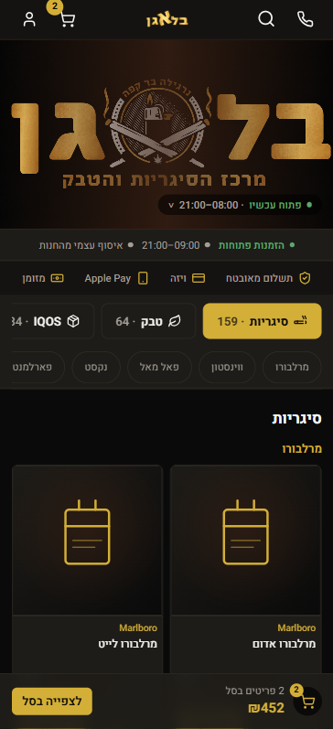
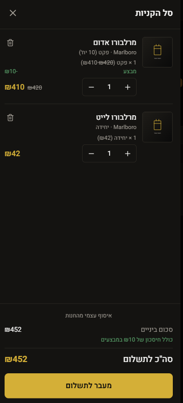
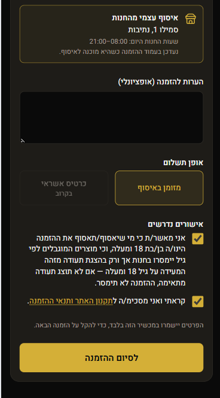
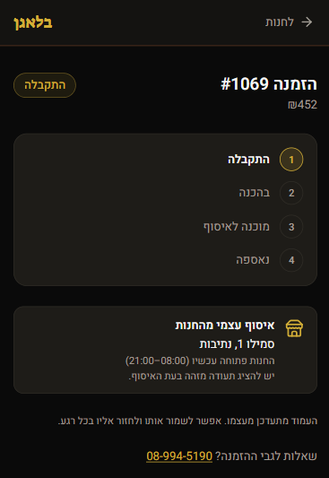
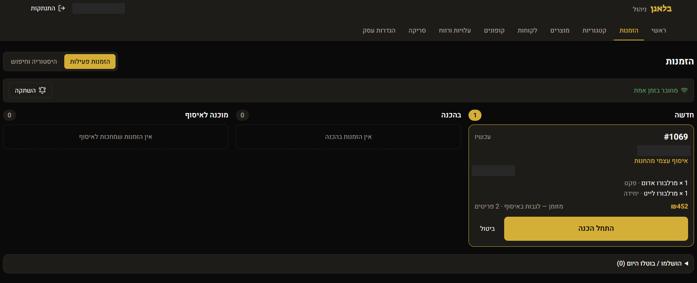
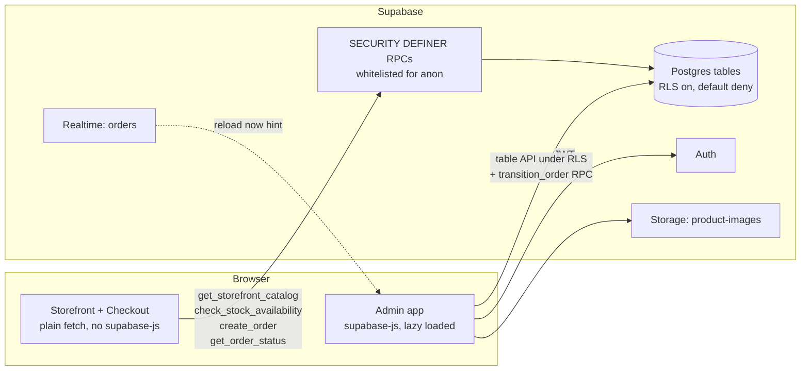

# Balagan

A Hebrew (RTL) e-commerce site and back-office for a physical tobacco store in Netivot, Israel: a static React SPA that talks directly to Supabase, with no server of its own.

**Live site:** https://balagan.netivot.workers.dev — **Pre-launch**: deployed, not yet announced to customers. Card payments are not connected, and the customer club login is switched off in production.

## Screenshots

<!-- Replace the placeholders with files under docs/screenshots/ -->

| Storefront | Cart | Checkout |
|---|---|---|
|  |  |  |

| Order tracking | Admin: active orders board |
|---|---|
|  |  |

## Features

### Customer side
- Catalog (categories → subcategories → products), loaded through one public RPC, with a localStorage cache and a bundled offline fallback catalog.
- Cart where each line is a product plus an explicit option (single unit or pack). Prices are read live from the catalog in integer agorot. Sale prices are shown.
- Stock check before adding to the cart (shared stock across unit and pack). If the check fails, the add is refused.
- Store hours and online-order hours computed in `Asia/Jerusalem`, minimum order, and a manual "orders paused" switch.
- Checkout at `/checkout`: re-validates the cart against the database on load, on tab refocus and before submit. Requires an 18+ confirmation and terms acceptance. Currently pickup only; delivery code exists but is switched off. Delivery is limited to a static list of Netivot streets.
- Cash orders are created for real. Card is shown as "coming soon".
- Order tracking page `/order/<uuid>` (polls every 30 s, no personal data) and a "last order" strip on the homepage.
- Guest details can be remembered on the same device (localStorage, deletable).

### Admin side (`/admin`)
- Categories and products: create, edit, hide, reorder, delete, optional image upload, shared inventory per product.
- Orders: active board (new → preparing → ready for pickup / out for delivery → completed), history and search, cancel with a required reason, stock restoration, status timeline with the acting account, sound alert for new orders.
- Settings: store hours, online-order hours, minimum order, delivery fee, pickup/delivery/payment-method switches, pause switch.
- Customers (owner only): member list, stats, audited CSV exports of marketing audiences.
- Coupons (owner only): percent / fixed / free delivery, usage limits, archive instead of delete.
- Barcode scanning for products (camera, `barcode-detector`).
- Works on a phone: tables turn into cards, covered by an automated layout test.

## Architecture & Security

There is no application server. `npm run build` outputs static files in `dist/`, served by Cloudflare Workers static assets. The browser calls Supabase (PostgREST RPCs, Auth, Storage, Realtime) with the public anon key only. The `service_role` key is not used anywhere in the project.



- **Row Level Security** is enabled on all 24 tables (34 policies across the migrations). Default is deny. Admin policies check `is_admin()`.
- **RPCs as the public API.** Anonymous visitors have no table access. They call a short list of `SECURITY DEFINER` functions that return explicit column whitelists (no barcode, no stock counts, no hidden rows). 50 SQL functions in total.
- **Roles.** `owner` (`is_admin()`: catalog, settings, customers, coupons), `staff` (shared terminal account, orders only, via `is_staff()`), club member (a `customers` row), and anonymous guest. Authorization comes from the `admin_users` allow-list, not from being logged in. The admin route guard is UX only; the database does the refusing.
- **Pricing and stock on the server.** `create_order()` prices the order itself (including sale prices and coupons) and deducts stock in the same transaction. The client never sends prices or discounts. The client-side stock check is a UX safeguard only.
- **Orders are written only through RPCs.** `authenticated` has no INSERT/UPDATE/DELETE on `orders` or `order_items`. `transition_order()` locks the row, checks the expected status (`STALE_STATUS` if another terminal moved it first), enforces the allowed-transition map, and records an append-only `order_status_events` row. The database also refuses orders while paused or outside the configured hours.
- **Idempotency.** The checkout sends a client-generated key, kept in `sessionStorage`, so a refresh or retry does not create a duplicate order.
- **Payment confirmation.** `confirm_payment()` exists in the schema and is granted only to `service_role`, so no browser session can call it. No payment provider or webhook is connected yet.
- **Bundle separation.** `/admin`, `/checkout`, `/order` and `/account` are loaded on demand; a unit test builds the app and fails if admin code or `supabase-js` leaks into the customer bundle.
- **Secrets.** `.env.local` is git-ignored; only `.env.example` is tracked. Only the public URL and anon key are baked into the build.

## Tech stack

- React 18, TypeScript, Vite 6, Tailwind CSS 3, lucide-react
- Supabase: Postgres, Row Level Security, Auth, Storage, Realtime
- `barcode-detector` (zxing-wasm) for the camera scanner, admin only
- Cloudflare Workers static assets (`wrangler.jsonc`, SPA fallback)
- Playwright for unit and end-to-end tests

## Database

16 SQL migrations in `supabase/migrations/`, applied in order (see `supabase/README.md`). Main tables:
- Catalog: `categories` → `subcategories` → `products`
- Orders: `orders` → `order_items`, `order_status_events`, `payment_attempts` → `payment_events`
- Customers: `customers`, `customer_consents`, `customer_addresses`
- Coupons: `coupons`, `coupon_redemptions`, `coupon_events`
- Config and access: `business_settings`, `business_hours`, `admin_users`

## Testing

```
npm run test:unit   # pure logic tests, no browser
npm run test:e2e    # storefront regression, checkout, admin, mobile layout (Playwright + Chrome)
```

- Roughly 400 test cases across `tests/` (account, admin, cart, catalog, checkout, order).
- `scripts/security-test.mjs` probes RLS, RPC and storage permissions against a real Supabase project, using credentials from environment variables.
- `scripts/verify-order-management.mjs` replays the migrations on an in-process Postgres (PGlite) and checks roles, transitions, restock and history.
- There is no CI pipeline in the repository; tests are run manually.

## Running locally

```
npm install
cp .env.example .env.local   # fill in your own Supabase URL and anon key
npm run dev                  # http://localhost:5173
npm run build                # typecheck + production build into dist/
```

- Create a Supabase project, apply `supabase/migrations/0001` to `0016` in order, then load `supabase/seed.sql`.
- Create the first admin user in Supabase Auth and add it to `admin_users`.
- Set `VITE_CATALOG_SOURCE=static` to run the storefront from the bundled catalog without a database.
- Never use the `service_role` key in `.env.local`.

## Status and roadmap

Implemented: catalog, cart, cash checkout, pickup flow, order tracking, admin (catalog, orders, settings, customers, coupons).

Not implemented yet:
- **Card payments:** no provider chosen. The schema (`payment_attempts`, `payment_events`, `confirm_payment()`) is ready. Still needed: Edge Functions for the redirect and a signature-verified webhook, plus a scheduled sweep for expired reservations.
- **Customer club:** database layer, login shell, personal area and coupons are built and tested, but switched off in production. There is no real SMS/OTP login adapter, and terms and privacy pages are missing.
- **Delivery:** code paths exist but are disabled; the launch is pickup only.
- **Owner MFA:** deferred.
- **CI/CD pipeline:** not configured in the repository.
